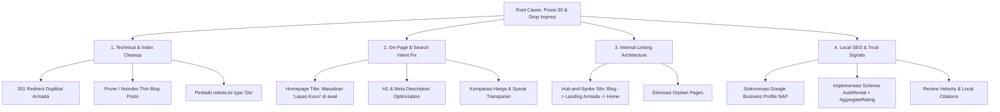

# 🎯 Rencana & Strategi SEO Menuju Top 10 Google Search: lepaskuncilombok.com

## Goal Description
Website `lepaskuncilombok.com` saat ini berada di **peringkat ~30 (Halaman 3)** untuk kata kunci utama seputar *"sewa mobil lombok lepas kunci"* / *"rental mobil lombok"*. Selain itu, data Google Search Console per September 2026 menunjukkan anomali kritis:
* **Penurunan tayangan (impressions)** drastis >90% (dari puncaknya ~1.852/hari menjadi ~150/hari).
* **Index bloat & kualitas rendah**: Terdapat **651 halaman "Di-crawl - saat ini tidak diindeks"** dan total **1.366 halaman tidak diindeks**.
* **Kanibalisasi kata kunci parah**: Terdapat puluhan URL armada kembar/duplikat (misal `sewa-fortuner-lombok-lepas-kunci-murah` vs `sewa-fortuner-lombok-2`, `sewa-toyota-avanza-lombok` vs `sewa-mobil-toyota-avanza-di-lombok-termurah`).
* **Tag Judul (Title Tag) Homepage tidak memuat target utama**: Homepage saat ini memiliki title `Sewa Mobil Lombok Harga Jujur, Unit Selalu Prima Mulai 300rb` yang **tidak memuat frasa "Lepas Kunci"**, padahal itu adalah kata kunci komersial utama dengan volume dan intensi transaksi tertinggi.

Target proyek ini adalah mengeksekusi strategi SEO teknis, on-page, dan arsitektural berbasis *white-hat best practice* untuk mendongkrak peringkat domain secara bertahap:
1. **Fase 1 (Minggu 1–2)**: Stop kebocoran otoritas (eliminasi kanibalisasi 301 redirect, perbaikan title tag & H1, noindex/purge thin content).
2. **Fase 2 (Minggu 3–4)**: Optimasi Search Intent, EEAT (Real reviews, armada matrix, pricing transparan), dan internal link siloing.
3. **Fase 3 (Bulan ke-2)**: Technical Core Web Vitals (mereduksi 409 KB DOM bloat) dan penguatan Local Entity SEO (GBP & local citations).
4. **Hasil Akhir**: Merangsek dari peringkat 30 ke **Top 10 (Halaman 1)** secara stabil.

---

## SERP Landscape & Analisis Pesaing (Realita Top 10 Lombok)
Berdasarkan SERP Google Indonesia untuk *"sewa mobil lombok lepas kunci"*:
* **Pesaing Korporasi (OTA)**: Traveloka, Tiket.com (mendominasi query umum, namun lemah di query spesifik lepas kunci lokal tanpa supir).
* **Pesaing Lokal Kuat**: `ayorentcarlombok.com`, `rendilomboktransport.id`, `tunjungtransport.com`, `wisatadilombok.com`.
* **Kelemahan Pesaing yang Bisa Dieksploitasi**:
  1. Banyak pesaing menyembunyikan harga asli atau syarat berbelit.
  2. Struktur skema (schema markup) pesaing masih usang (tidak lengkap GeoCoordinates, Car Catalog, FAQPage, AggregateRating real).
  3. Desain mobile pesaing lambat dan form order WhatsApp tidak instan.
  4. Domain `lepaskuncilombok.com` memiliki **Exact Match Domain (EMD)** advantage untuk "lepas kunci lombok" yang belum dimaksimalkan karena title tag saat ini tidak memanfaatkannya!

---

## User Review Required
> [!IMPORTANT]
> **Keputusan Redireksi 301 untuk Halaman Duplikat Armada**:
> Kami menemukan 8 pasang halaman armada yang saling kanibal di sitemap (misal Avanza, Innova, Hiace, Brio, Xpander). Kita harus memilih 1 URL kanonis permanen (slug bersih) dan melakukan 301 redirect dari URL duplikatnya ke URL utama agar PageRank terakumulasi, bukan terpecah.
>
> Contoh pilihan slug utama:
> * `https://lepaskuncilombok.com/sewa-toyota-avanza-lombok/` (KEEP) ⬅ 301 redirect dari `/sewa-mobil-toyota-avanza-di-lombok-termurah/`
> * `https://lepaskuncilombok.com/sewa-innova-reborn-lombok/` (KEEP) ⬅ 301 redirect dari `/sewa-innova-reborn-lombok-2/` dan `/sewa-innova-reborn-lombok-dengan-harga-termurah/`
> * `https://lepaskuncilombok.com/sewa-brio-lombok/` (KEEP) ⬅ 301 redirect dari `/sewa-mobil-brio-di-lombok-murah-2026/`

> [!WARNING]
> **Pembersihan 651 Halaman "Crawled - Currently Not Indexed"**:
> Google menolak mengindeks 651 URL tersebut karena dinilai bernilai rendah (*thin/low value content*), seperti postingan blog usang hasil spin/AI tanpa trafik atau arsip tag kosong. Jika dibiarkan, ini menurunkan *site-wide domain quality score*. Kita merekomendasikan:
> 1. Audit 400+ artikel blog.
> 2. Artikel yang 0 impresi & 0 klik dalam 6 bulan terakhir: beri tag `noindex, follow` atau hapus + 410 Gone / 301 ke artikel pilar terdekat.
> 3. Pertahankan hanya artikel yang memiliki impresi atau relevan dengan rute sewa mobil Lombok (Mandalika, Sembalun, Bandara ZAM, Senggigi).

---

## Open Questions
1. **Target Keyword Utama yang Paling Diprioritaskan**:
   Apakah prioritas #1 mutlak adalah *"sewa mobil lombok lepas kunci"* atau *"rental mobil lombok"* secara umum? (Sangat krusial untuk penempatan kata pertama pada `<title>` tag homepage).
2. **Akses ke WordPress / Server**:
   Apakah Anda mengelola perubahan ini via WordPress Dashboard (Yoast SEO / Redirection Plugin / WP Rocket) atau melalui child theme PHP / `.htaccess` / Cloudflare Page Rules?

---

## Proposed Changes



---

### Component 1: On-Page Optimization (Homepage & Primary Landing Pages)

#### [MODIFY] Homepage SEO Meta (Yoast SEO Setting / WordPress Header)
* **Masalah**: Title saat ini tidak memiliki frasa "Lepas Kunci" di awal dan terlalu generik:
  * *Lama*: `<title>Sewa Mobil Lombok Harga Jujur, Unit Selalu Prima Mulai 300rb</title>`
* **Perbaikan**:
  * *Title Baru (Maks 60 Karakter)*:
    ```html
    <title>Sewa Mobil Lombok Lepas Kunci Mulai 300rb | CV. Lepas Kunci Lombok</title>
    ```
  * *Meta Description Baru (Maks 155 Karakter)*:
    ```html
    <meta name="description" content="Sewa mobil Lombok lepas kunci &amp; plus driver mulai 300rb/24 jam. Bebas antar-jemput Bandara Lombok (BIL) &amp; Mataram. Unit bersih, terawat, proses syarat mudah." />
    ```
  * *Heading Structure*:
    * **H1**: `Sewa Mobil Lombok Lepas Kunci Murah & Terpercaya`
    * **H2 (Fitur)**: `Pilihan Armada Rental Mobil Lepas Kunci di Lombok (Manual & Matic)`
    * **H2 (Keunggulan)**: `Keuntungan Sewa Mobil Tanpa Driver di CV. Lepas Kunci Lombok`
    * **H2 (Syarat)**: `Syarat & Ketentuan Sewa Mobil Lepas Kunci di Lombok`
    * **H2 (FAQ)**: `FAQ Sewa Mobil Lepas Kunci Lombok`

---

### Component 2: Resolusi Kanibalisasi Kata Kunci & Redirect Matrix (301 Mappings)

Untuk memulihkan PageRank yang terpecah dan menyelesaikan 117+ redirect error serta 253 canonical conflict:

#### [MODIFY] File Konfigurasi `.htaccess` / WordPress Redirection Rules
```apache
# --- 301 REDIRECT CANNIBALIZED CAR PAGES TO CANONICAL URLS ---
Redirect 301 /sewa-mobil-toyota-avanza-di-lombok-termurah/ /sewa-toyota-avanza-lombok/
Redirect 301 /sewa-innova-reborn-lombok-dengan-harga-termurah/ /sewa-innova-reborn-lombok/
Redirect 301 /sewa-innova-reborn-lombok-2/ /sewa-innova-reborn-lombok/
Redirect 301 /sewa-hiace-premio-lombok/ /sewa-toyota-hiace-premio/
Redirect 301 /sewa-toyota-hiace-lombok/ /sewa-toyota-hiace-premio/
Redirect 301 /sewa-fortuner-lombok-lepas-kunci-murah/ /sewa-fortuner-lombok/
Redirect 301 /sewa-fortuner-lombok-2/ /sewa-fortuner-lombok/
Redirect 301 /sewa-mobil-brio-di-lombok-murah-2026/ /sewa-brio-lombok/
Redirect 301 /sewa-mobil-mitsubishi-xpander-di-lombok-2026/ /sewa-xpander-lombok/
Redirect 301 /sewa-alphard-di-lombok/ /sewa-toyota-alphard-lombok/
Redirect 301 /sewa-mobil-pajero-di-lombok-harga-termurah/ /sewa-pajero-sport-lombok/
```

---

### Component 3: robots.txt & Crawl Budget Sanitization

#### [MODIFY] Live `robots.txt`
* **Masalah**: Pada live site ditemukan typo di baris terakhir:
  ```txt
  User-agent: CCBot
  Dis
  ```
  Ini invalid syntax di robots.txt.
* **Perbaikan**:
```txt
# START ROBOTS.TXT LEPAS KUNCI LOMBOK
User-agent: *
Disallow: /wp-admin/
Allow: /wp-admin/admin-ajax.php
Disallow: /?s=
Disallow: /page/*/?s=
Disallow: /search/
Disallow: /wp-json/
Disallow: /?rest_route=
Disallow: /trackback/
Disallow: /feed/
Disallow: /*/feed/

# Block AI Scrapers that waste crawl budget
User-agent: CCBot
Disallow: /

User-agent: GPTBot
Disallow: /

Sitemap: https://lepaskuncilombok.com/sitemap_index.xml
# END ROBOTS.TXT
```

---

### Component 4: Content Pruning & Topic Cluster (Silo Architecture)

Saat ini domain memiliki 400+ postingan blog artikel wisata yang membuat Google kewalahan dan menandai 651 URL sebagai *"Di-crawl - saat ini tidak diindeks"*.

#### Eksekusi Content Audit 3 Kategori:
1. **Keep & Optimize (Top 30 Artikel Berbobot)**:
   * Artikel yang memiliki korelasi langsung dengan sewa mobil:
     * `panduan-sewa-mobil-lepas-kunci-di-lombok-untuk-wisatawan-pemula`
     * `rute-mandalika-terbaik-menggunakan-mobil-sewa-spot-foto-tiket-masuk-dan-estimasi-bbm`
     * `itinerary-wisata-lombok-4-hari-3-malam-lengkap`
     * `sewa-mobil-bandara-lombok`
   * *Aksi*: Tambahkan link kontekstual (*in-content anchor link*) ke Homepage dan Landing Page Armada terkait:
     * Contoh anchor: `[sewa mobil lepas kunci di Lombok](https://lepaskuncilombok.com/)`, `[rental mobil Brio Lombok](https://lepaskuncilombok.com/sewa-brio-lombok/)`.
2. **Merge / Consolidate**:
   * Artikel pantai sejenis digabung menjadi 1 mega-guide: "15 Pantai Terbaik di Lombok yang Wajib Dikunjungi dengan Mobil Sewa".
3. **Noindex / Prune**:
   * Artikel tipis (<300 kata), artikel usang (event MotoGP tahun lama), atau artikel tanpa impresi diberi meta `noindex, follow` di Yoast SEO.

---

### Component 5: Technical SEO & Core Web Vitals (Pengurangan HTML DOM 409 KB)

* **Masalah**: Homepage HTML payload saat ini mencapai 409 KB karena puluhan tag `<style>` inline yang disisipkan berulang kali di setiap Gutenberg block (`src/pages/homepage/all.html`).
* **Perbaikan**:
  1. Ekstrak seluruh inline CSS di block Gutenberg menjadi satu file stylesheet eksternal terkompresi yang dicache oleh browser dan Cloudflare CDN (`assets/css/homepage.min.css`).
  2. Pastikan tag hero LCP image memiliki atribut preload:
     ```html
     <link rel="preload" as="image" href="https://lepaskuncilombok.com/wp-content/uploads/2026/07/hero-bg-desktop.webp" fetchpriority="high">
     ```
  3. Defer script pihak ketiga yang tidak esensial di *above-the-fold*.

---

### Component 6: Schema.org & Local SEO (Google Business Profile Synergy)

Untuk query rental mobil di Google Indonesia, **Local 3-Pack** dan faktor kedekatan (proximity) menyumbang 40-50% traffic.
* **Perbaikan Schema JSON-LD**:
  Perbarui schema AutoRental dengan menghubungkan `sameAs` ke profil Google Maps & sosial resmi:
  ```json
  {
    "@context": "https://schema.org",
    "@type": "AutoRental",
    "@id": "https://lepaskuncilombok.com/#autorental",
    "name": "CV. Lepas Kunci Lombok",
    "alternateName": ["Lepas Kunci Lombok", "Rental Mobil Lombok Lepas Kunci"],
    "url": "https://lepaskuncilombok.com",
    "telephone": "+6282339022477",
    "priceRange": "Rp 300.000 - Rp 1.500.000",
    "currenciesAccepted": "IDR",
    "paymentAccepted": "Cash, Bank Transfer",
    "address": {
      "@type": "PostalAddress",
      "streetAddress": "Pelembak, Jl. Koperasi No.178, Pejeruk, Kec. Ampenan",
      "addressLocality": "Mataram",
      "addressRegion": "Nusa Tenggara Barat",
      "postalCode": "83113",
      "addressCountry": "ID"
    },
    "geo": {
      "@type": "GeoCoordinates",
      "latitude": -8.5670919,
      "longitude": 116.0895996
    },
    "hasMap": "https://maps.app.goo.gl/AsmdSMNb8E8nji1N8",
    "sameAs": [
      "https://www.instagram.com/lepaskuncilombok/",
      "https://maps.app.goo.gl/AsmdSMNb8E8nji1N8"
    ]
  }
  ```

---

### Component 7: Strategi Off-Page & Authority Building (Bukan PBN / Spam)

Google update terbaru mendiskualifikasi PBN murahan. Strategi yang terbukti bekerja di niche rental wisata:
1. **Local Tourism & Media Outreach**:
   * Publikasi rilis berita lokal / advertorial di portal media NTB (Radar Lombok, Suara NTB, Lombok Post, Detik Bali-Nusra). Tautan dari portal berita lokal NTB memberikan sinyal geo-relevansi terkuat ke Google.
2. **Travel Blogger Partnership**:
   * Kolaborasi dengan travel blogger yang menulis panduan "Keliling Lombok 3 Hari 2 Malam". Berikan potongan sewa untuk pertukaran review jujur dan backlink dofollow kontekstual.
3. **Optimasi Google Business Profile (GBP)**:
   * Buat SOP: Setiap pelanggan yang selesai mengembalikan mobil dikirimkan template link review Google Maps via WhatsApp.
   * Dapatkan minimal 3-5 ulasan bintang 5 baru per minggu dengan menyebutkan kata kunci alami di ulasan (misal: *"sewa avanza lepas kunci di bandara lombok pelayanannya cepat"*).

---

## Verification Plan

### Automated Tests & Audit
* **Screaming Frog / Site Bulb Crawl**:
  * Pastikan 0 status code 404 pada internal links.
  * Pastikan 100% halaman armada kembar merespon `HTTP 301 Moved Permanently` ke URL kanonis.
  * Pastikan tidak ada canonical chain / loops.
* **Google Rich Results Test**:
  * Uji URL `https://lepaskuncilombok.com` di [Rich Results Test](https://search.google.com/test/rich-results) untuk memastikan validasi `AutoRental`, `FAQPage`, dan `BreadcrumbList` tanpa error.
* **PageSpeed Insights & Lighthouse**:
  * Skor Mobile Performance di atas 75+.
  * LCP < 2.5s, CLS < 0.1, INP < 200ms.

### Manual Verification
1. **Google Search Console**:
   * Pantau tab *Indexing > Pages*: Pastikan angka "Di-crawl - saat ini tidak diindeks" turun secara bertahap dari 651 menuju <50.
   * Submit sitemap baru pasca-pruning.
2. **Peringkat Keyword Tracking**:
   * Lacak posisi harian via GSC Search Results filter Query:
     * *"sewa mobil lombok lepas kunci"*
     * *"rental mobil lombok lepas kunci"*
     * *"sewa mobil lombok"*
     * *"sewa mobil mataram"*
   * Target milestone:
     * Minggu ke-2: Naik dari rank 30 ke rank 18-22.
     * Minggu ke-4: Naik ke rank 11-15.
     * Minggu ke-6 s/d 8: Masuk rank 4-9 (Top 10 Page 1).
